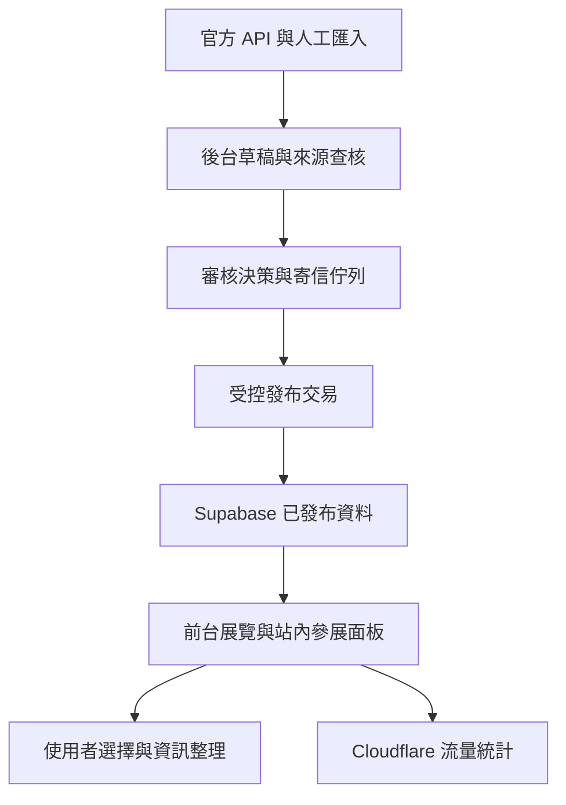

# 天道商貿｜架構與實際進度

更新：2026-10-27（台灣時間）。本文件區分正式環境觀測與開發分支測試。

## 產品要求

商展優先；使用者選擇展覽後，在站內查看參展面板、食衣住行玩樂及時段參考，並整理已選資訊。平台只提供資訊，不代訂、不收款。多來源資料須有來源、去重、查核與審核流程。保留正式站既有功能與 Cloudflare 統計。採完整自動化 B 方案，驗證通過後才能發布。

這是目標架構；下表才是目前接通程度。

| 層 | 正式／已確認現況 | 尚缺 |
|---|---|---|
| 前台 | 正式頁成功載入 293 筆已發布資料，畫面依有效日期顯示 286 筆；選取後可在站內看詳情，周邊面板仍顯示尚未接通 | 商展覆蓋率、手機驗收、周邊真實資料 |
| 管理後台 | 1 位 publisher；已有管理介面 | 真實使用者登入及 MFA 流程驗收 |
| 資料庫 | TianDao-Global-B2B；PostgreSQL 17.11；313 筆：293 published、20 draft | 受控發布與審核資料表部署 |
| 資料來源 | 4 筆來源設定；6 筆來源待辦 | 設定存在不等於同步排程啟用 |
| 同步 | culture v4、taipei v3 ACTIVE | 正式 Taipei v3 仍會覆寫既有資料；新版未部署 |
| Gmail／寄信 | 開發模組及測試存在 | 正式 OAuth、服務端入口、權杖保管、真實寄收信驗證 |
| 審核／outbox | 正式資料庫尚無相關資料表 | 不得把程式已提交視為系統已啟用 |
| 排程 | 未安裝 pg_cron／沒有 cron.job | 尚未確認外部排程；不可宣稱自動同步運作中 |
| 統計 | 歷史紀錄確認 Cloudflare 已安裝 | 本次沒有讀取即時統計 |

## 正式 Supabase 唯讀實測

- 匿名角色：293 筆可見，非公開／已刪除資料可見數為 0。
- authenticated 角色、未帶使用者身分：293 筆可見、管理員角色為 NULL、非公開資料可見數為 0。這不是網站登入驗收。
- canonical_key 無重複；唯一約束存在。
- 已有 exhibition_category、source_checked_at；不用再套舊 migration。
- 發布狀態 CHECK 僅允許 draft/published/archived；event_type 不接受 activity。
- 已驗證的 Auth MFA 使用者數為 0。後續 MFA 註冊需使用者自行完成。
- 安全顧問提示公開 SECURITY DEFINER、密碼外洩檢查未開；需逐項判讀，不能一律撤銷 helper 權限而破壞 RLS。
- organizations、exhibition_source_backlog、exhibition_admin_profiles 有 anon/authenticated TRUNCATE 權限。這是資料庫權限缺口，不代表 PostgREST 已提供 TRUNCATE HTTP 端點；本次未改正式權限。
- Supabase 測試分支建立回傳僅 Pro 以上支援；沒有升級、沒有付費。

## 本次程式修正

1. 修正聯盟連結測試的 ul → li → a 路徑，原功能不變。
2. 加入 GitHub 隔離 PostgreSQL 17 服務，實際執行 7 份草稿 SQL；Auth 函式及必要基礎表使用最小 fixture，非正式 Supabase 全量複本。
3. 實際 SQL 測試發現 PostgreSQL 不接受正規表示式 `{1,256}`，改成明確長度檢查加字元白名單，保留 256 字元上限。
4. 審核／通知表草稿 migration 明確撤銷 anon/authenticated 權限，避免依賴 RLS 擋住不受 RLS 管控的 TRUNCATE。
5. 展期統一轉 Asia/Taipei，再取日期，避免 UTC 截字造成早一天；已補跨日及無效日期測試。
6. 臺北同步開發版改為只新增 draft；使用 canonical_key + ignoreDuplicates 保留已發布、已封存及既有草稿，並以回傳新增 ID 計數。一般觀光活動使用合法 other 類型，待人工分類；這不是已完成來源更新審核流程。

## 驗證證據與限制

- commit 12d2805：原有離線 CI 通過。
- commit 5a6a4ee：隔離 PostgreSQL 交易測試及離線測試兩個 jobs 都通過（run 40463091665）。
- 實際 SQL 涵蓋一次性授權、重複 Gmail ID 回滾、錯誤 evidence 回滾、非法／過長 ID、舊 Boolean MFA RPC 移除、客戶端權限、禁止直接發布及 outbox 租約。
- 最新 commit 0ef4caee：雙 PostgreSQL session 競爭同一授權及臺北同步模擬測試全部通過（run 40463418128，兩個 jobs 成功）。
- 沒有真正寄信、沒有完成 Google OAuth、沒有在正式環境部署草稿 SQL 或同步新版，沒有合併 main。

## 接續順序

1. 最新 CI 全部通過，檢查 PR #3 的合併衝突與正式版本差異。
2. 選定隔離 Supabase 測試專案，核對 schema、RLS、Auth 與 Edge Functions；GitHub PostgreSQL 通過不取代此步驟。
3. 建立真實服務端 OAuth／MFA／審核入口與排程，使用安全設定保存密鑰，再做端到端驗收。
4. 逐場查核首批商展與來源使用條款；現有十筆候選仍阻擋，不能改旗標假裝完成。
5. 驗收站內參展面板、選取資訊、食衣住行與手機版後，再正式發布。
